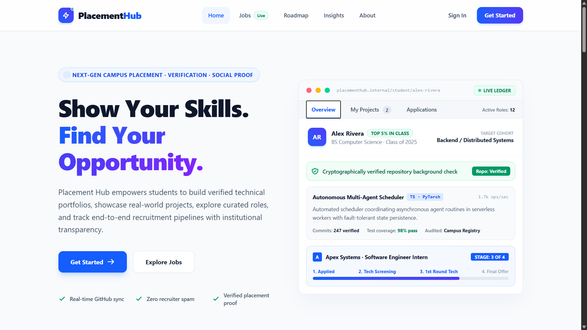
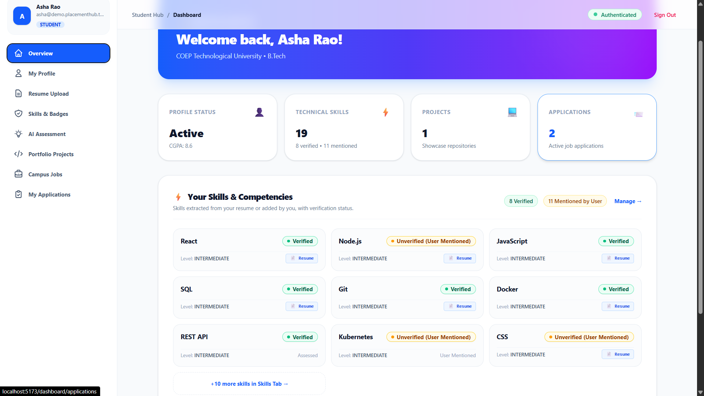
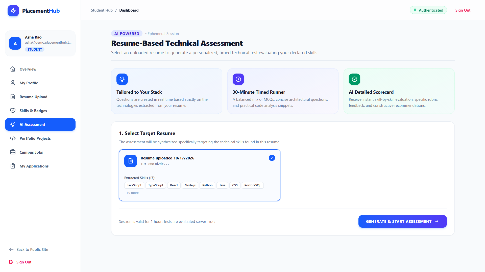
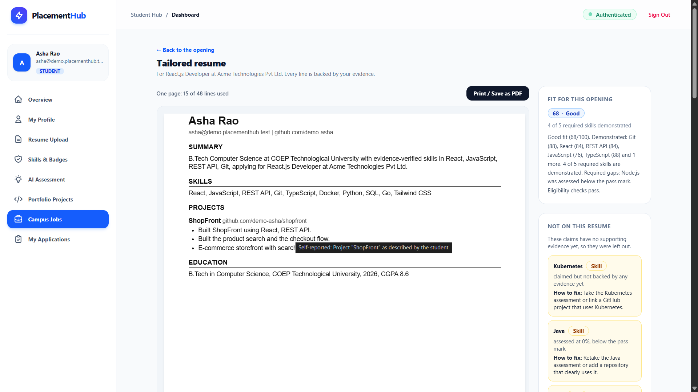
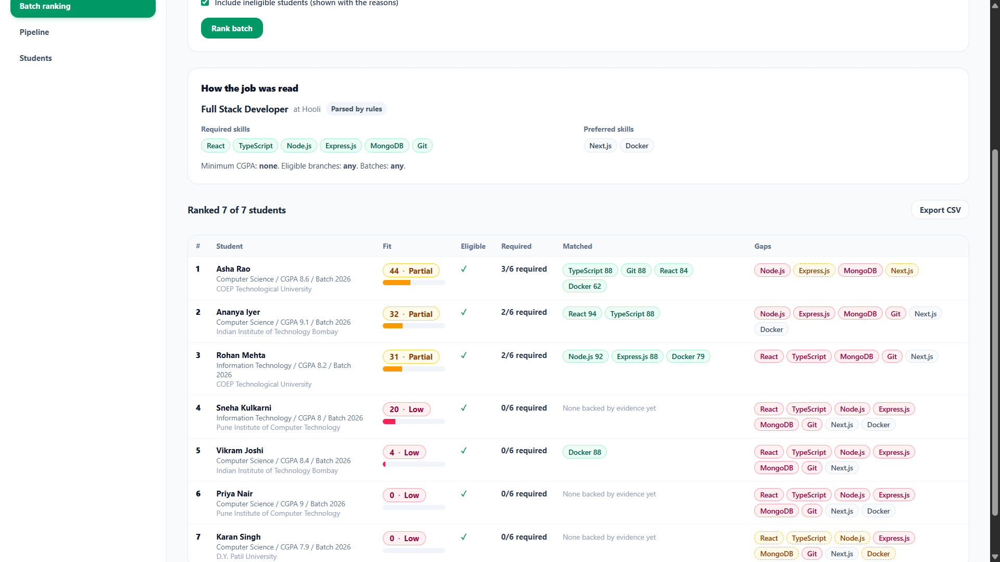
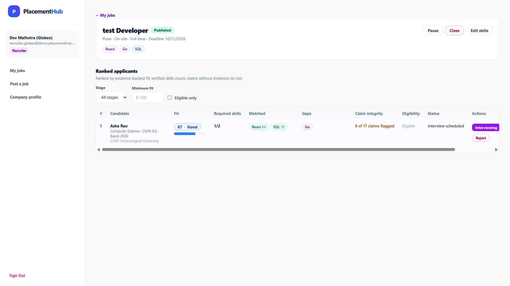
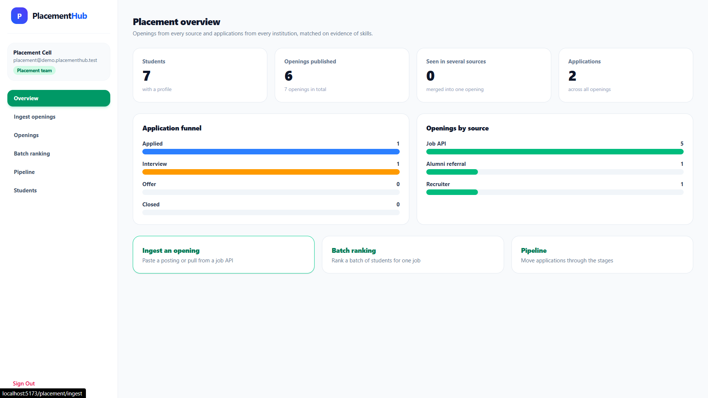
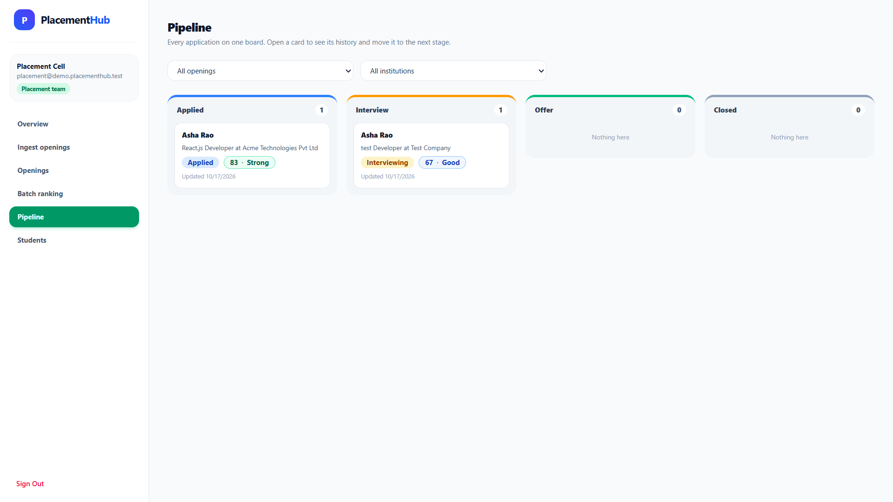

<div align="center">

# PlacementHub

**Evidence-based campus placement platform for students, recruiters, and placement teams.**

Match students to openings on *verified* skills, generate truthful job-specific resumes, and track every application through a shared pipeline.




</div>

---

## Table of Contents

- [Overview](#overview)
- [Features](#features)
- [Screenshots](#screenshots)
- [Tech Stack](#tech-stack)
- [System Architecture](#system-architecture)
- [Repository Structure](#repository-structure)
- [Getting Started](#getting-started)
- [Configuration](#configuration)
- [Demo Accounts](#demo-accounts)
- [Docker](#docker)
- [Scripts](#scripts)
- [API](#api)

## Overview

Resumes claim skills; they rarely prove them. PlacementHub closes that gap. Students upload a resume, the platform parses it into normalized skills and projects, and then corroborates those claims through an AI-generated assessment and public GitHub repository analysis. Placement teams and recruiters work from the same verified data, so ranking, shortlisting, and hiring decisions rest on evidence rather than keywords.

## Features

### For students
- **Resume parsing:** upload a PDF or DOCX and get structured skills, projects, and experience.
- **Skill verification:** a generated assessment per skill, combined with GitHub evidence into an explainable 0–100 score.
- **Job fit:** see how well you match each opening, with matched and missing skills called out.
- **Truthful resume builder:** generate a job-specific resume that only includes claims backed by evidence, with a claim check before you apply.
- **Application tracking:** follow each application from applied to hired.

### For recruiters
- Post and manage openings with required skills, eligible branches, and graduation years.
- Review ranked applicants with resume snapshots and verified-skill breakdowns.
- Move candidates through the pipeline with status controls.

### For placement teams
- **Job ingestion:** paste a job description or pull from external sources; postings are parsed and de-duplicated.
- **Batch ranking:** rank a cohort of students against an opening.
- **Pipeline oversight:** monitor all applications and student readiness across the institution.

## Screenshots

| Student dashboard | Skill verification |
| :---: | :---: |
|  |  |
| **Resume builder** | **Job fit and matching** |
|  |  |
| **Recruiter portal** | **Placement team portal** |
|  |  |

<p align="center">
  
</p>

## Tech Stack

| Layer | Technologies |
| --- | --- |
| **Frontend** | React 19, Vite, TypeScript, Tailwind CSS 4, React Router 7 |
| **Backend** | Bun, Express 5, TypeScript, Zod, Helmet, express-rate-limit |
| **Database** | PostgreSQL, Prisma 7 (`@prisma/adapter-pg`) |
| **Auth** | JWT access tokens (`jose`), refresh sessions, Argon2 password hashing, role-based access |
| **AI and integrations** | Google Gemini (resume/job parsing, assessments), GitHub REST API (skill evidence) |
| **Tooling** | Docker Compose, ESLint, `bun test` |

## System Architecture

```
┌──────────────────────┐   REST /api/v1   ┌────────────────────────────┐   Prisma   ┌──────────────┐
│  React + Vite SPA    │ ───────────────▶ │  Express API (Bun)         │ ─────────▶ │  PostgreSQL  │
│  Student · Recruiter │ ◀─────────────── │  auth · matching · resume  │            └──────────────┘
│  · Placement portals │                  │  assessment · pipeline     │
└──────────────────────┘                  └─────────────┬──────────────┘
                                                        │ optional
                                          ┌─────────────┴──────────────┐
                                          │  Gemini · GitHub API       │
                                          └────────────────────────────┘
```

1. **Frontend:** role-based portals (student, recruiter, placement) in a single SPA.
2. **Backend API:** authentication, role enforcement, job ingestion, skill matching, resume generation, and pipeline transitions.
3. **Database:** users, institutions, skills and aliases, projects, evidence, jobs, applications, and application events.
4. **Integrations:** AI parsing and GitHub verification are optional and degrade gracefully when not configured.

### Verification model

- The **assessment** is the primary signal of demonstrated knowledge.
- **GitHub analysis** is supporting evidence only. It does not prove authorship, and missing or private repositories never lower a score.
- Scoring is deterministic TypeScript with unit tests, not an LLM call.

See [per-skill-github-assessment-scoring-implementation.md](backend/per-skill-github-assessment-scoring-implementation.md) for the full design.

## Repository Structure

```
PlacementHub/
├── backend/            # API, business logic, Prisma schema/migrations, tests
│   ├── src/            # routes, services, matching, github, assessment, resume, scoring
│   ├── prisma/         # schema, migrations, seed script
│   └── tests/          # bun test suites
├── frontend/           # React application
│   └── src/            # pages, components, api clients, auth context
├── docker/             # Dockerfiles for backend and frontend
├── docs/screenshots/   # README images
└── docker-compose.yml
```

## Getting Started

### Prerequisites

- [Bun](https://bun.sh) 1.2 or later
- A PostgreSQL database (local or hosted, such as Supabase)
- *Optional:* a Gemini API key and a GitHub token for AI parsing and verification

### 1. Install dependencies

```bash
cd backend && bun install
cd ../frontend && bun install
cd .. && bun install   # root, for the combined dev script
```

### 2. Configure the environment

```bash
cp backend/.env.example backend/.env
```

Fill in `backend/.env`. At a minimum set `DATABASE_URL`, `DIRECT_URL`, `JWT_ACCESS_SECRET`, `RECRUITER_SIGNUP_CODE`, and `PLACEMENT_SIGNUP_CODE`. See [Configuration](#configuration).

### 3. Set up the database

```bash
cd backend
bunx prisma generate --config prisma7.config.ts
```

Apply the SQL under `backend/prisma/migrations` to your database (helpers: `prisma/apply-schema.mjs`, `prisma/apply-sql.mjs`).

Optionally seed demo data:

```bash
bun run prisma/seed.ts
```

### 4. Run the app

From the repository root:

```bash
bun run dev
```

| Service | URL |
| --- | --- |
| Frontend | http://localhost:5173 |
| Backend API | http://localhost:4000/api/v1 |
| Health check | http://localhost:4000/api/v1/health |

## Configuration

Environment variables live in `backend/.env` (template: [`backend/.env.example`](backend/.env.example)).

| Variable | Required | Description |
| --- | :---: | --- |
| `DATABASE_URL` / `DIRECT_URL` | Yes | PostgreSQL connection strings |
| `JWT_ACCESS_SECRET` | Yes | Secret used to sign access tokens |
| `RECRUITER_SIGNUP_CODE` | Yes | Invite code required to register as a recruiter |
| `PLACEMENT_SIGNUP_CODE` | Yes | Invite code required to register as a placement officer |
| `FRONTEND_URL` | No | Allowed CORS origin(s), comma separated |
| `GEMINI_API_KEY` / `GEMINI_MODEL` | No | Enables AI resume/job parsing and assessments |
| `JOB_PARSE_LLM` | No | Set `false` to parse jobs with built-in rules only |
| `INGEST_USE_FIXTURES` | No | Set `true` to ingest from `backend/fixtures/jobs` instead of public APIs |
| `GITHUB_TOKEN` | No | Raises GitHub rate limits for skill verification |
| `RATE_LIMIT_WINDOW_MINUTES` / `RATE_LIMIT_MAX_REQUESTS` | No | API rate limiting |

> Never commit `.env` files or expose `GITHUB_TOKEN` and `GEMINI_API_KEY` to the client.

## Demo Accounts

After running the seed script, every demo account uses the password `Demo@12345`.

| Role | Email |
| --- | --- |
| Placement team | `placement@demo.placementhub.test` |
| Recruiter | `recruiter.acme@demo.placementhub.test`, `recruiter.globex@demo.placementhub.test` |
| Students | printed by the seed script (`asha@demo.placementhub.test`) |

> For local development only. Do not seed demo data into a production database.

## Docker

```bash
docker compose up --build
```

This builds and starts the backend (`:4000`) and frontend (`:5173`). The backend reads its configuration from `backend/.env`.

## Scripts

**Repository root**

| Command | Description |
| --- | --- |
| `bun run dev` | Run backend and frontend together |

**`backend/`**

| Command | Description |
| --- | --- |
| `bun run dev` | Start the API with hot reload |
| `bun run start` | Start the API |
| `bun run test` | Run backend tests |
| `bun run build` | Type-check the backend |

**`frontend/`**

| Command | Description |
| --- | --- |
| `bun run dev` | Start the Vite dev server |
| `bun run lint` | Lint the frontend |
| `bun run build` | Type-check and build for production |

## API

All endpoints are served under `/api/v1`.

| Prefix | Purpose |
| --- | --- |
| `/auth` | Sign up, sign in, token refresh |
| `/students` | Student profile, resume, skills, projects, applications |
| `/jobs` | Public and student-facing job listings and fit |
| `/assessments` | Generate, submit, and score skill assessments |
| `/recruiter` | Recruiter job management and applicant review |
| `/placement` | Job ingestion, batch ranking, pipeline, student overview |
| `/institutions` | Institution data |

Applications move through: `APPLIED → IN_REVIEW → SHORTLISTED → INTERVIEW_SCHEDULED → INTERVIEWING → OFFERED → HIRED`, with `REJECTED` and `WITHDRAWN` as terminal states.
